# Mid-Project Komunikasi Data dan Jaringan Komputer
# Implementasi Jaringan Smart City Kota Surabaya
### Link Vidio Demo
https://youtu.be/OmJ-dyXi8ck 

# SOAL 1 - Perancangan Topologi
## 1.1 Gambar Topologi

 
## 1.2 Skema Pengalamatan yang Dipilih: VLSM
 
Kelompok kami memilih **VLSM**. Alasannya:
 
| Alasan | Penjelasan |
|---|---|
| Kebutuhan host sangat beragam | Ukuran LAN berkisar dari 20 host (Server Balai Kota) sampai 11.000 host (WiFi Publik Utara). VLSM memberi tiap subnet blok yang sesuai kebutuhannya. |
| Lebih efisien | Total subnet memakai 61.752 dari 65.536 alamat pada blok /16, atau sekitar **94,2%**. Skema CIDR pada data yang sama membutuhkan blok /15 karena supernet tiap router dibulatkan ke pangkat dua, dengan pemakaian sekitar 52%. |
| Perhitungan mudah diperiksa | Setiap subnet dihitung langsung dari kebutuhan hostnya, tanpa pohon penggabungan per router. |
| Konsekuensi yang diterima | Rute antar-router tidak dapat diringkas per router, sehingga jumlah baris routing lebih banyak dibanding CIDR. |
 
**Blok dasar: 10.104.0.0/16**
 
- Oktet ke-2 adalah 8 × 13 = **104** (nomor kelompok 13).
- Blok 10.0.0.0/8 adalah rentang alamat privat.
- /16 dipilih karena total kebutuhan sekitar 61.752 alamat, sedangkan /17 hanya menyediakan 32.768.
- Kebutuhan alamat tiap subnet dihitung sebagai host + 3 (network ID, broadcast, dan gateway), lalu dibulatkan ke pangkat dua terdekat.
- Subnet dialokasikan dari blok terbesar ke terkecil agar setiap network ID jatuh tepat pada batas bloknya.
**Alamat tambahan (tidak dihitung dalam blok di atas):**
 
| Keperluan | Alamat |
|---|---|
| Link R-PUSAT ke R-ISP | 203.0.113.52/30 (4 × 13) |
| Server internet | 8.8.8.0/24, Server 8.8.8.8, gateway 8.8.8.1 di R-ISP |

## 1.3 Prinsip Desain 
- Backbone (R-ISP, R-PUSAT, link L1 sampai L6) dan server 8.8.8.8 disusun sesuai skema pada soal
- Satu perangkat perwakilan per LAN, perhitungan subnet tetap memakai jumlah host penuh
- Setiap LAN diberi label nama subnet, Network ID/prefix, dan jumlah host.

## 1.4 Pemilihan Perangkat
 
| Perangkat | Dipakai untuk | Alasan |
|---|---|---|
| Router 2911 | R-ISP, R-DC, R-BARAT, R-TIMUR, R-SELATAN, R-PELABUHAN | Memiliki 3 port GigabitEthernet bawaan, sedangkan kebutuhan keenam router ini paling banyak 3 port. |
| Router-PT-Empty + modul PT-ROUTER-NM-1CGE | R-PUSAT dan R-UTARA | R-PUSAT butuh 8 port dan R-UTARA 4 port, melebihi 3 port bawaan 2911. Port Gigabit ditambah lewat modul. |
| Switch 2960-24TT | Sembilan LAN kabel (lihat 1.7) | Satu LAN berisi banyak host, sehingga perlu satu titik kumpul. |
| Server-PT | SRV-INTERNET, SRV-BALAIKOTA, SRV-DC | Perlu menjalankan layanan (Web, DNS, DHCP, FTP, Email) pada tab Services. |
| PC-PT | Pegawai, sensor, CCTV, PJU, SCADA, kantor, puskesmas | Mewakili perangkat pengguna atau perangkat IoT yang meminta IP dinamis. |
| Access Point-PT | LAN WiFi Publik | Menyediakan akses nirkabel bagi warga. |
| Smartphone-PT | Klien WiFi Publik | Memiliki kartu jaringan wireless bawaan. PC-PT biasa hanya mendukung kabel. |
 
## 1.5 Media Link dan Jenis Kabel
 
**Media link**
 
| Lokasi | Media | Alasan |
|---|---|---|
| Backbone antar-router | Kabel | Jalur utama harus stabil dan mengikuti Gambar 1. |
| Server (Balai Kota, DC, Internet) | Kabel | Menjalankan layanan penting yang harus selalu tersedia. |
| CCTV Kota | Kabel | Rekaman video membutuhkan bandwidth besar dan koneksi tanpa putus ke server FTP. |
| Sensor (lalu lintas, banjir, SCADA) dan PJU Pintar | Kabel | Perangkat tetap yang datanya tidak boleh hilang karena gangguan sinyal. |
| Pegawai Balai Kota, Kantor Pelabuhan, Puskesmas dan Sekolah | Kabel | Perangkat kerja tetap yang butuh koneksi stabil. |
| WiFi Publik (Utara, Timur, Selatan, Barat) | Wireless | Dipakai warga dengan perangkat bergerak. |
 
**Jenis kabel**
 
| Menghubungkan | Kabel |
|---|---|
| Router ke Router | Copper Cross-Over |
| Router ke Switch atau Access Point | Copper Straight-Through |
| Switch ke PC atau Server | Copper Straight-Through |
| Router langsung ke Server (SRV-INTERNET, SRV-BALAIKOTA) | Copper Straight-Through (sesuai topologi, link menyala hijau) |
| Access Point ke Smartphone | Wireless (SSID yang sama) |
 
## 1.6 Penambahan Port pada Router
 
| Router | Link ke router lain | LAN | Total port | Solusi |
|---|---|---|---|---|
| R-ISP | 1 (ke R-PUSAT) | 1 (SRV-INTERNET) | 2 | Port bawaan 2911 |
| R-PUSAT | 6 (R-ISP, L1 sampai L5) | 2 | **8** | Router-PT-Empty + 8 modul NM-1CGE |
| R-DC | 1 | 2 | 3 | Port bawaan 2911 |
| R-BARAT | 1 | 2 | 3 | Port bawaan 2911 |
| R-UTARA | 2 (L2, L6) | 2 | **4** | Router-PT-Empty + 4 modul NM-1CGE |
| R-TIMUR | 1 | 2 | 3 | Port bawaan 2911 |
| R-SELATAN | 1 | 2 | 3 | Port bawaan 2911 |
| R-PELABUHAN | 1 | 2 | 3 | Port bawaan 2911 |
 
**Pemetaan port**
 
| Router | Port | Tujuan |
|---|---|---|
| R-PUSAT | G0/0 | R-ISP |
| | G1/0 | L1 ke R-DC |
| | G2/0 | L2 ke R-UTARA |
| | G3/0 | L3 ke R-SELATAN |
| | G4/0 | L4 ke R-TIMUR |
| | G5/0 | L5 ke R-BARAT |
| | G6/0 | LAN Pegawai Balai Kota |
| | G7/0 | LAN Server Balai Kota |
| R-UTARA | G0/0 | L2 ke R-PUSAT |
| | G1/0 | L6 ke R-PELABUHAN |
| | G2/0 | LAN WiFi Publik Utara |
| | G3/0 | LAN Sensor Lalu Lintas Utara |
 
Router 2911 (G0/0, G0/1, G0/2):
 
| Router | G0/0 | G0/1 | G0/2 |
|---|---|---|---|
| R-ISP | ke R-PUSAT | SRV-INTERNET | tidak dipakai |
| R-DC | L1 ke R-PUSAT | LAN CCTV Kota | LAN Server dan Storage DC |
| R-BARAT | L5 ke R-PUSAT | LAN WiFi Barat | LAN Puskesmas dan Sekolah |
| R-TIMUR | L4 ke R-PUSAT | LAN WiFi Timur | LAN Sensor Banjir |
| R-SELATAN | L3 ke R-PUSAT | LAN WiFi Selatan | LAN PJU Pintar |
| R-PELABUHAN | L6 ke R-UTARA | LAN Sensor SCADA | LAN Kantor Pelabuhan |
 
## 1.7 Desain per Lokasi
 
| Router | LAN | Perangkat pengumpul | Perangkat perwakilan | Media |
|---|---|---|---|---|
| R-PUSAT | Pegawai Balai Kota | SW-PEGAWAI-BALAIKOTA | PC-PEGAWAI-BALAIKOTA | Kabel |
| R-PUSAT | Server Balai Kota | langsung ke router | SRV-BALAIKOTA | Kabel |
| R-DC | CCTV Kota | SW-CCTV-KOTA | PC-CCTV-KOTA | Kabel |
| R-DC | Server dan Storage DC | SW-DC | SRV-DC | Kabel |
| R-BARAT | WiFi Publik Barat | AP-WIFI-BARAT | HP-WIFI-BARAT | Wireless |
| R-BARAT | Puskesmas dan Sekolah Barat | SW-PUSKESMAS-BARAT | PC-PUSKESMAS-BARAT | Kabel |
| R-UTARA | WiFi Publik Utara | AP-WIFI-UTARA | HP-WIFI-UTARA | Wireless |
| R-UTARA | Sensor Lalu Lintas Utara | SW-SENSOR-LALIN | PC-SENSOR-LALIN | Kabel |
| R-TIMUR | WiFi Publik Timur | AP-WIFI-TIMUR | HP-WIFI-TIMUR | Wireless |
| R-TIMUR | Sensor Banjir Timur | SW-SENSOR-BANJIR | PC-SENSOR-BANJIR | Kabel |
| R-SELATAN | WiFi Publik Selatan | AP-WIFI-SELATAN | HP-WIFI-SELATAN | Wireless |
| R-SELATAN | PJU Pintar Selatan | SW-PJU-SELATAN | PC-PJU-SELATAN | Kabel |
| R-PELABUHAN | Sensor dan SCADA Pelabuhan | SW-SCADA-PELABUHAN | PC-SCADA-PELABUHAN | Kabel |
| R-PELABUHAN | Kantor Pelabuhan | SW-KANTOR-PELABUHAN | PC-KANTOR-PELABUHAN | Kabel |
 
## 1.8 Alasan dan Pertimbangan Desain
 
1. **Switch pada LAN kabel.** Satu LAN berisi puluhan sampai ribuan host, sedangkan satu port router hanya menerima satu kabel. Switch menjadi titik kumpul, dan satu LAN tetap memakai satu port router. Setiap LAN memakai switch sendiri karena tiap LAN adalah subnet yang berbeda, sehingga tidak perlu VLAN.
2. **Access Point langsung ke router.** Access Point sudah berfungsi sebagai perangkat akses yang menampung banyak klien nirkabel, dan simulasi hanya memakai satu AP per LAN. Jika kelak AP ditambah, switch dapat disisipkan tanpa mengubah subnet.
3. **Server Balai Kota langsung ke router.** LAN ini diwakili satu server sesuai ketentuan soal. Jika LAN sebenarnya berisi lebih dari satu server, ditambahkan switch tanpa mengubah subnet.
4. **Kabel untuk perangkat tetap, wireless untuk warga.** Sensor, CCTV, server, dan kantor membutuhkan koneksi stabil. WiFi Publik dipakai perangkat bergerak, sehingga memakai wireless.
5. **Tunnel dan layanan tidak digambar di topologi.** Topologi hanya memuat perangkat dan kabel fisik.
6. **Perangkat perwakilan.** Satu perangkat per LAN sudah cukup. Perhitungan subnet tetap memakai jumlah host penuh.

# SOAL 2
## Tabel Subnetting
Spreadsheet lengkap: <a href="https://docs.google.com/spreadsheets/d/1yMvPR45FCVxfc-NhGsegs_fDxxSXmV0BuXG8RNnOhl0/edit?gid=636640205#gid=636640205">K13_Subnetting.xlsx</a>
<br>
Skema yang dipakai pada topologi adalah VLSM dengan blok dasar `10.104.0.0/16`. Tabel pengalamatan CIDR dan supernet per router ada pada sheet CIDR di spreadsheet yang sama. Perhitungan UTS kami periksa ulang. Semua subnet berubah, dan hampir seluruhnya berasal dari beberapa kesalahan yang saling menurun


# SOAL 3 
### Penjelasan singkat
Membuat semua LAN Smart City Surabaya saling terhubung menggunakan **static routing**: R-PUSAT memiliki static route ke semua LAN cabang, router cabang memiliki default route ke R-PUSAT, dan R-UTARA memiliki static route ke LAN R-PELABUHAN. R-ISP sengaja **tidak** diberi route ke `10.104.0.0/16` (disiapkan untuk Soal 5 NAT). Output file baru: `v2_static.pkt` (file asli `v1.pkt` tidak diubah).

### Proses pengerjaan
1. Ganti `SW-PEGAWAI-BALAIKOTA` dari router 2911 ke switch 2960; hubungkan `R-PUSAT Gi6/0 ↔ SW-PEGAWAI Fa0/1`, `PC-PEGAWAI Fa0 ↔ SW-PEGAWAI Fa0/2`, dan `SRV-DC Fa0 ↔ SW-DC Fa0/2`.
2. Set IP static: `PC-PEGAWAI = 10.104.224.10/21` (gw `10.104.224.1`), `SRV-DC = 10.104.239.10/24`, `PC-CCTV = 10.104.96.10/19`.
3. Tambahkan static route di R-PUSAT ke setiap LAN cabang (contoh: `10.104.96.0/19 via 10.104.241.34`, `10.104.239.0/24 via 10.104.241.34`, `10.104.236.0/23 via 10.104.241.38`, `10.104.238.0/24 via 10.104.241.50`).
4. Tambahkan default route di setiap router cabang ke R-PUSAT (R-DC via `10.104.241.33`, R-UTARA via `10.104.241.37`, dst.).
5. Tambahkan static route R-UTARA → Pelabuhan: `10.104.160.0/19` dan `10.104.240.0/25 via 10.104.241.54`.
6. Jangan tambahkan route internal di R-ISP.
7. Perbaiki binding kabel agar endpoint tidak tertimpa port switch (urutan endpoint dibalik).

### Verifikasi
- `PC-PEGAWAI`: `ipconfig` → IP `10.104.224.10/21`, gw `10.104.224.1`.
- `ping 10.104.224.1` → 4/4 reply.
- `ping 10.104.96.10` (CCTV) → reply (percobaan kedua, ARP/STP warm-up).
- R-PUSAT: `show ip route` → static route ke LAN cabang + default `0.0.0.0/0 via 203.0.113.54`.
- Router cabang: `show ip route` → default route via R-PUSAT; R-UTARA juga route ke `10.104.160.0/19` & `10.104.240.0/25`.
- R-ISP: `show ip route` → **tidak** ada route ke `10.104.0.0/16`.
- Workspace List → Links = 31, Devices = 39; tidak ada `Router0/Switch1/PC0`.
## Soal 4 
### Penjelasan singkat
Seluruh end device (pengguna) diubah dari IP static menjadi **DHCP** (IP, mask, gateway, DNS otomatis). Interface router dan server tetap static. Subnet CCTV (`10.104.96.0/19`) mendapat DHCP dari `SRV-DC` (pool `CCTV-KOTA`) via `ip helper-address 10.104.239.10` pada `R-DC Gi0/1`, bukan dari R-DC. Dibuat 11 pool router + 1 pool CCTV. DNS semua pool = `10.104.239.10`. Output: `v4_dhcp.pkt`.
### Proses pengerjaan
1. Buat 11 pool DHCP di router (PEGAWAI, WIFI-UTARA, SENSOR-LALIN, WIFI-TIMUR, SENSOR-BANJIR, WIFI-BARAT, PUSKESMAS, WIFI-SELATAN, PJU-SELATAN, SCADA-PELABUHAN, KANTOR-PELABUHAN) dengan network/mask/gateway sesuai VLSM dan `dns-server 10.104.239.10`, `excluded-address` = gateway.
3. Buat pool `CCTV-KOTA` di `SRV-DC` (Services → DHCP): network `10.104.96.0/19`, gw `10.104.96.1`, DNS `10.104.239.10`, start `10.104.96.2`.
4. Set `ip helper-address 10.104.239.10` pada `R-DC Gi0/1`; pastikan R-DC tidak punya pool CCTV.
5. Set 12 end device ke `DHCP=true` dan kosongkan field IP static.
6. Pastikan router/server tetap static.
### Verifikasi
- R-PUSAT: `show running-config` → `ip dhcp pool PEGAWAI` + `dns-server 10.104.239.10`.
- SRV-DC → Services → DHCP → pool `CCTV-KOTA` (network `10.104.96.0/19`, gw `10.104.96.1`, DNS `10.104.239.10`).
- R-DC: `show running-config interface GigabitEthernet0/1` → `ip helper-address 10.104.239.10`.
- `PC-CCTV-KOTA`: `ipconfig /all` → IP `10.104.96.2`, gw `10.104.96.1`, DHCP server `10.104.239.10`, DNS `10.104.239.10`.
- HP lease: UTARA `10.104.0.2`, TIMUR `10.104.128.2`, SELATAN `10.104.64.2`, BARAT `10.104.192.3`.
- `nslookup www.k13.smartcity.lab` dan `ping www.k13.smartcity.lab` dari PC DHCP → reply.
- Link = 31, device = 39; server/router static tetap.

# SOAL 5 
### Penjelasan singkat
Seluruh host internal (`10.104.0.0/16`) mengakses internet lewat **satu IP publik** milik R-PUSAT menggunakan **NAT overload (PAT)**. R-ISP tetap tanpa route ke internal. Output: `v5_nat.pkt`.

### Proses pengerjaan
1. Di R-PUSAT:
   - `Gi0/0` (IP publik `203.0.113.53/30` ke R-ISP) → `ip nat outside`.
   - `Gi1/0`–`Gi7/0` (link internal + 2 LAN Balai Kota) → `ip nat inside`.
   - `access-list 1 permit 10.104.0.0 0.0.255.255`.
   - `ip nat inside source list 1 interface GigabitEthernet0/0 overload`.
3. Biarkan R-ISP tanpa static route ke internal (hanya tahu `203.0.113.52/30` dan `8.8.8.0/24`).
4. `SRV-INTERNET = 8.8.8.8/24`, gw `8.8.8.1`; R-ISP `Gi0/1 = 8.8.8.1/24`.

### Verifikasi
- R-PUSAT: `show running-config` → `ip nat outside` (Gi0/0), `ip nat inside` (Gi1/0–Gi7/0), ACL `10.104.0.0 0.0.255.255`, `ip nat inside source list 1 interface GigabitEthernet0/0 overload`.
- R-ISP: `show ip route` → tidak ada route ke `10.104.0.0/16`.
- `PC-PEGAWAI`: `ping 8.8.8.8` → `Reply from 8.8.8.8` (ping pertama boleh timeout karena ARP warm-up, ulangi).
- R-PUSAT: `show ip nat statistics` → Outside `Gi0/0`, Inside 7 interface, `Hits > 0`, `Expired translations > 0`.
- DHCP/layanan/routing internal tetap berfungsi.

# SOAL 6 
### Penjelasan singkat
Membuat **GRE tunnel** `Tunnel0` antara R-PUSAT (Balai Kota) dan R-PELABUHAN, sehingga lalu lintas antara kedua area harus lewat tunnel (menggantikan jalur via R-UTARA). Dilengkapi dokumentasi: mengapa tunnel vs jalur biasa, dan mengapa GRE tidak mengenkripsi (bonus IPsec). Output: `v6_gre.pkt`.

### Proses pengerjaan
1. Upgrade IOS R-PUSAT dari `pt_12.2` ke `2900_universal_base_15.1` agar mendukung `interface Tunnel` (port & IP tetap).
3. Konfigurasi GRE tunnel:
   - R-PUSAT: `Tunnel0` IP `192.168.0.1/30`, source `Gi2/0` (`10.104.241.37`), dest `10.104.241.54`.
   - R-PELABUHAN: `Tunnel0` IP `192.168.0.2/30`, source `Gi0/0` (`10.104.241.54`), dest `10.104.241.37`.
4. Route lewat tunnel:
   - R-PUSAT: `10.104.160.0/19` dan `10.104.240.0/25 via 192.168.0.2`.
   - R-PELABUHAN: `10.104.224.0/21` dan `10.104.241.0/27 via 192.168.0.1`.
5. Dokumentasi alasan: tunnel membuat link point-to-point logis langsung sehingga traffic Balai Kota ↔ Pelabuhan tidak bergantung routing R-UTARA; GRE hanya encapsulation (bukan encryption), payload tetap plaintext → perlu IPsec untuk kerahasiaan.

### Verifikasi
- R-PUSAT: `show ip interface brief` → `Tunnel0` up/up, IP `192.168.0.1`.
- R-PUSAT: `ping 192.168.0.2` → 5/5 (percobaan pertama boleh 2/5, ulangi).
- R-PUSAT: `traceroute 10.104.240.1` → hop pertama `192.168.0.2` (tunnel, bukan R-UTARA).
- `PC-PEGAWAI` (Balai Kota): `ping 10.104.240.1` dan `ping 10.104.160.1` → reply; sebaliknya dari Pelabuhan ke Balai Kota juga berhasil.
- R-PUSAT & R-PELABUHAN: `show running-config` → cek Tunnel0 + route via `192.168.0.x`.
- DHCP/NAT/layanan/routing internal tetap berfungsi; link = 31, device = 39.

# SOAL 7
### Penjelasan singkat
Seluruh static route antar-router diganti dengan **OSPF** (process 1, area 0) di file terpisah `K13_VLSM_OSPF.pkt`. Ditambahkan link cadangan **L7** antara R-DC dan R-UTARA memakai alamat yang belum terpakai, `10.104.241.56/30` (blok /30 pertama setelah L6). Interface LAN dibuat `passive-interface` agar OSPF tidak mengirim pesan ke LAN pengguna. Default route ke internet hanya dikonfigurasi di R-PUSAT dan disebarkan ke router lain dengan `default-information originate`. Jika link backbone putus, OSPF otomatis memindahkan jalur lewat L7.

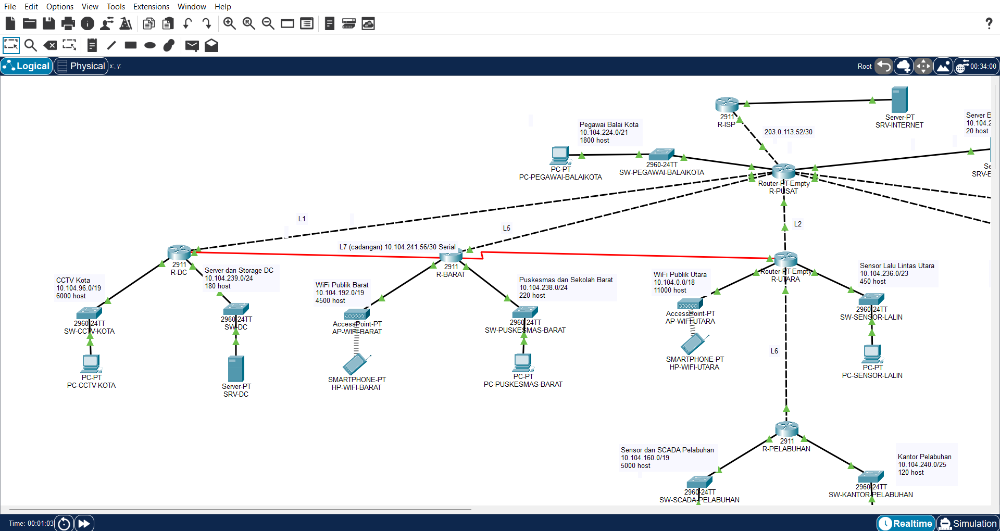

### Proses pengerjaan
1. Salin file utama menjadi `K13_VLSM_OSPF.pkt`.
2. Pasang link serial **L7**: R-DC `Serial0/3/0` = `10.104.241.57/30` (ujung DCE, `clock rate 2000000`) ↔ R-UTARA `Serial9/0` = `10.104.241.58/30`.
3. Hapus semua static route antar-router. Yang tersisa hanya `ip route 0.0.0.0 0.0.0.0 203.0.113.54` di R-PUSAT dan 2 rute tunnel GRE dari Soal 6 (`10.104.160.0/19` dan `10.104.240.0/25 via 192.168.0.2`).
4. Konfigurasi OSPF di setiap router: `router ospf 1`, `router-id`, dan `network ... area 0` untuk link backbone dan LAN.

   | Router | Router-ID | Network yang diiklankan | Passive interface |
   |---|---|---|---|
   | R-PUSAT | 1.1.1.1 | L1–L5, `10.104.224.0/21`, `10.104.241.0/27` | Gi6/0, Gi7/0 |
   | R-DC | 2.2.2.2 | L1, L7, `10.104.96.0/19`, `10.104.239.0/24` | Gi0/1, Gi0/2 |
   | R-UTARA | 3.3.3.3 | L2, L6, L7, `10.104.0.0/18`, `10.104.236.0/23` | Gi2/0, Gi3/0 |
   | R-SELATAN | 4.4.4.4 | L3, `10.104.64.0/19`, `10.104.240.128/25` | Gi0/1, Gi0/2 |
   | R-TIMUR | 5.5.5.5 | L4, `10.104.128.0/19`, `10.104.232.0/22` | Gi0/1, Gi0/2 |
   | R-BARAT | 6.6.6.6 | L5, `10.104.192.0/19`, `10.104.238.0/24` | Gi0/1, Gi0/2 |
   | R-PELABUHAN | 7.7.7.7 | L6, `10.104.160.0/19`, `10.104.240.0/25` | Gi0/1, Gi0/2 |

5. R-PUSAT: `default-information originate` agar default route tersebar otomatis ke semua router (muncul sebagai `O*E2`).

**Alasan desain**
- **Kenapa L7 hanya jadi cadangan:** cost OSPF = 100.000 ÷ bandwidth. Link Gigabit cost 1, sedangkan L7 serial cost 64 dari sisi R-DC (BW 1544 Kbit) dan 781 dari sisi R-UTARA (BW 128 Kbit, bawaan Router-PT). Contohnya dari R-DC ke WiFi Utara: lewat L1–L2 cost 3, lewat L7 cost 65, sehingga OSPF memilih L1–L2 saat normal.
- **Kenapa static route tunnel GRE tetap ada:** lalu lintas Balai Kota ↔ Pelabuhan wajib lewat tunnel (Soal 6). AD static (1) lebih kecil dari OSPF (110), jadi rute tunnel tetap dipakai. Tunnel tidak dimasukkan ke OSPF untuk menghindari *recursive routing*.
- **Cakupan redundansi:** L7 memberi jalur cadangan untuk segitiga R-PUSAT – R-DC – R-UTARA (L1, L2, L7). Router lain hanya punya satu link ke backbone.

### Verifikasi
- R-PUSAT `show ip protocols` → `ospf 1`, Router ID `1.1.1.1`, network area 0, passive `Gi6/0` dan `Gi7/0`.
  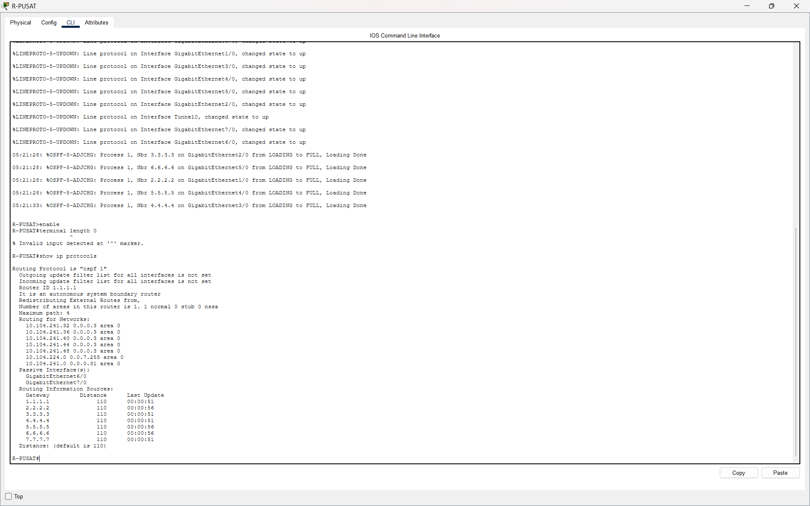
- R-PUSAT `show ip ospf neighbor` → 5 neighbor **FULL**. `show running-config | include ip route` → hanya default ke ISP dan 2 rute tunnel GRE.
  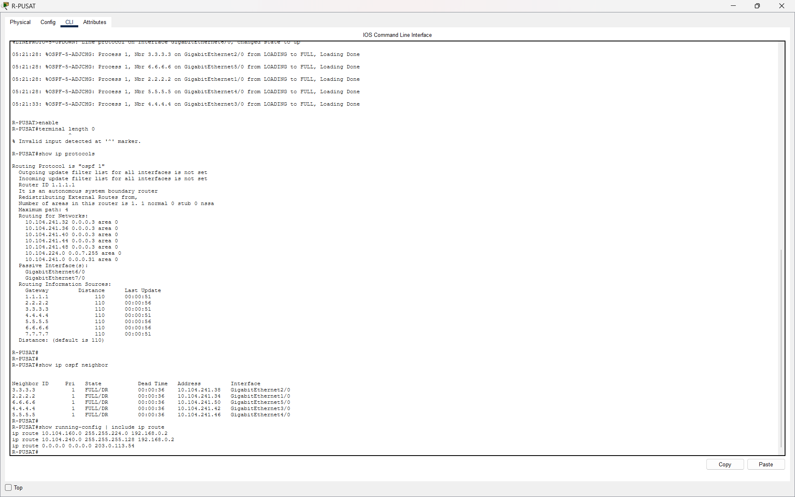
- R-UTARA → 3 neighbor FULL, termasuk `2.2.2.2` lewat `Serial9/0` (L7). Default route `O*E2 0.0.0.0/0 via 10.104.241.37` didapat dari OSPF.
  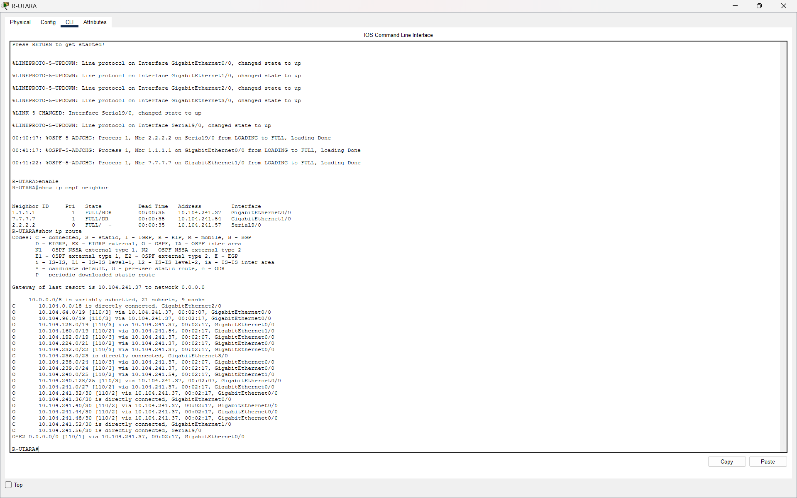
- R-DC → `show running-config | include ip route` kosong (tidak ada static route). 2 neighbor FULL. Default `O*E2 via 10.104.241.33`.
  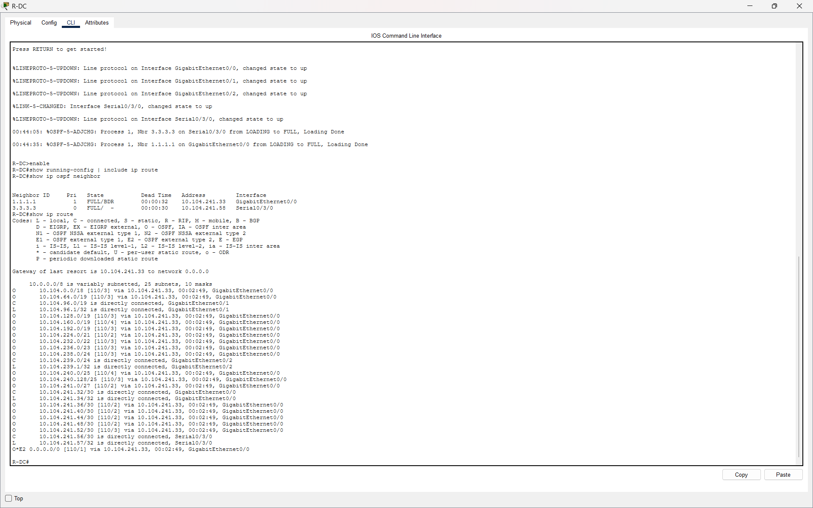
- **Uji failover** (sumber `PC-PEGAWAI-BALAIKOTA` 10.104.224.2, tujuan `SRV-DC` 10.104.239.10):
  - `tracert` sebelum: `10.104.224.1` → `10.104.241.34` → `10.104.239.10` (lewat L1).

    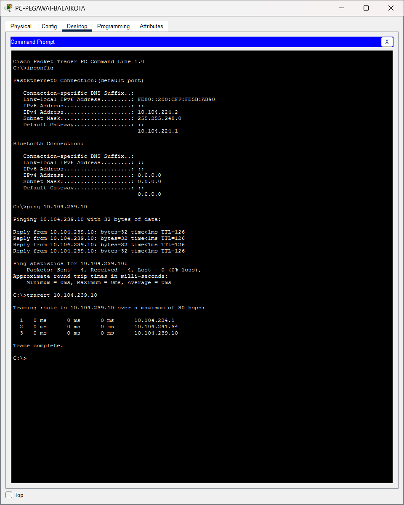
  - `ping -t`, lalu L1 diputus dengan `shutdown` di R-PUSAT `Gi1/0`. Ping RTO 1 kali lalu pulih otomatis (Sent 28, Received 27, Lost 1). TTL berubah dari 126 ke 125 karena jalur bertambah satu router. Log R-PUSAT: `Nbr 2.2.2.2 ... from FULL to DOWN`.
    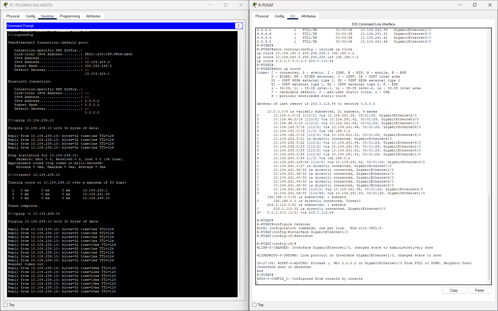
  - `tracert` sesudah: `10.104.224.1` → `10.104.241.38` (R-UTARA) → `10.104.241.57` (R-DC lewat L7) → `10.104.239.10`.

    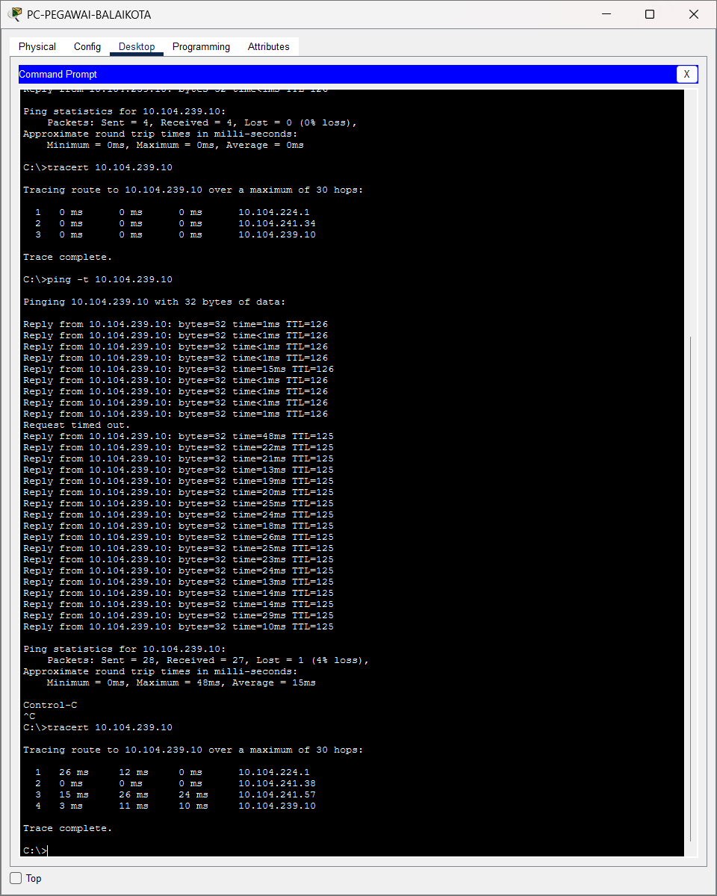
  - R-DC saat L1 putus → semua rute dan default `O*E2` lewat `10.104.241.58 Serial0/3/0`.
    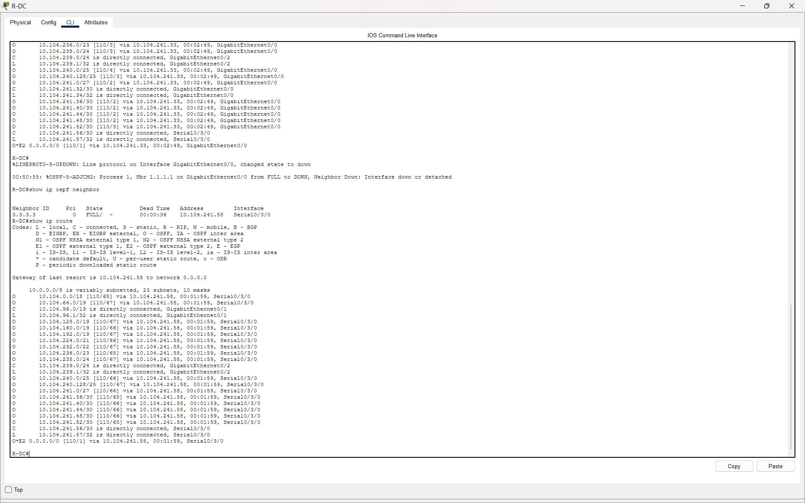
  - L1 disambung kembali (`no shutdown`) → log `Nbr 2.2.2.2 ... from LOADING to FULL`, dan `tracert` kembali lewat `10.104.241.34`.
    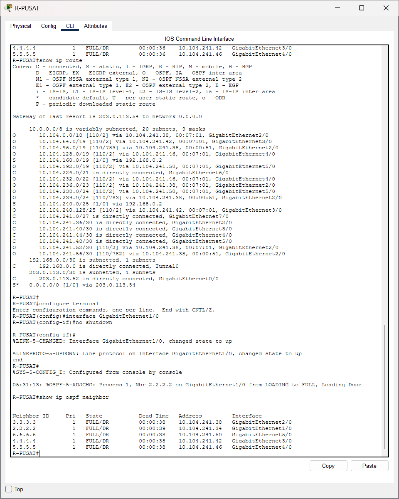
    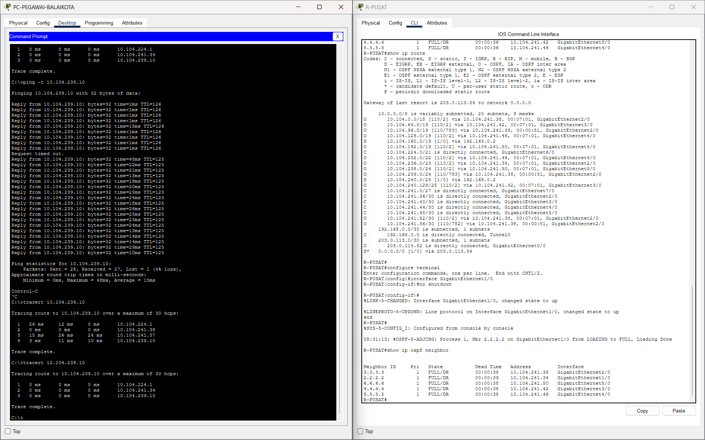


# SOAL 8 - Layanan Aplikasi Smart City

Domain internal yang dipakai: **k13.smartcity.lab**

### 8.1 Ringkasan Layanan

| Soal | Layanan | Dijalankan di | Nama domain | Protokol | Diakses dari |
|---|---|---|---|---|---|
| 8a | DNS | SRV-DC (LAN Server dan Storage DC) | - | DNS (UDP 53) | Seluruh wilayah |
| 8b | Web "Portal Smart City Surabaya" | SRV-BALAIKOTA (LAN Server Balai Kota) | www.k13.smartcity.lab | HTTP (TCP 80) | Seluruh wilayah |
| 8c | FTP penyimpanan rekaman CCTV | SRV-DC (LAN Server dan Storage DC) | ftp.k13.smartcity.lab | FTP (TCP 21) | LAN CCTV Kota (unggah) |
| 8d | Email antarpegawai | [ISI: server email, mis. SRV-BALAIKOTA] | mail.k13.smartcity.lab | SMTP (TCP 25) dan POP3 (TCP 110) | Pengguna Balai Kota dan Pelabuhan |

Alamat IP server (statis, sesuai soal 4):

| Server | LAN | IP | Mask | Gateway |
|---|---|---|---|---|
| SRV-DC | 10.104.239.0/24 | 10.104.239.[ISI] | 255.255.255.0 | 10.104.239.1 |
| SRV-BALAIKOTA | 10.104.241.0/27 | 10.104.241.[ISI] | 255.255.255.224 | 10.104.241.1 |

### 8.2 DNS (Soal 8a)

SRV-DC dipilih sebagai server DNS karena soal menempatkan DNS di LAN Server dan Storage DC.

**Konfigurasi di SRV-DC:** buka tab **Services**, pilih **DNS**, lalu nyalakan **DNS Service (On)**. Tambahkan record bertipe **A Record**:


**Pengujian:** dari satu perangkat di setiap wilayah, jalankan di Command Prompt:

```
nslookup www.k13.smartcity.lab
nslookup ftp.k13.smartcity.lab
nslookup mail.k13.smartcity.lab
```


### 8.3 Web "Portal Smart City Surabaya" (Soal 8b)

**Konfigurasi di SRV-BALAIKOTA:** buka tab **Services**, pilih **HTTP**, nyalakan **HTTP (On)**. Ubah berkas **index.html** menjadi halaman portal yang memuat nomor kelompok, misalnya:

```html
<html>
  <head><title>Portal Smart City Surabaya</title></head>
  <body>
    <h1>Portal Smart City Surabaya</h1>
    <p>Kelompok 13</p>
  </body>
</html>
```

**Pengujian:** dari perangkat di setiap wilayah, buka **Web Browser** dan akses `http://www.k13.smartcity.lab`. Halaman harus tampil dengan judul dan nomor kelompok.


### 8.4 FTP Rekaman CCTV (Soal 8c)

FTP ditempatkan di SRV-DC sebagai penyimpanan rekaman CCTV, dan akses mewajibkan akun login.

**Konfigurasi di SRV-DC:** buka tab **Services**, pilih **FTP**, nyalakan **FTP Service (On)**. Pada daftar akun: <br>
**Langkah**:Tambah akun `cctv` dengan password `cctv` dan izin **Write, Read, Delete, Rename, List** <br> 
**Tujuan**: Akun untuk perangkat CCTV mengunggah rekaman <br>


**Pengujian dari PC-CCTV-KOTA:**

1. Buat berkas contoh lewat **Desktop, Text Editor**, simpan sebagai `rekaman.txt`.
2. Buka **Command Prompt** dan jalankan:

```
ftp ftp.k13.smartcity.lab
Username: cctv
Password: cctv123
ftp> put rekaman.txt
ftp> dir
```

3. Berkas muncul pada daftar `dir`, dan juga pada tab Services, FTP di SRV-DC.
4. Percobaan login dengan akun yang salah harus ditolak.


**Pengujian dari : Host Lain (Kantor Pelabuhan)**
1. Buka **Command Prompt** dan jalankan:

```
ftp ftp.k13.smartcity.lab
Username: cctv
Password: cctv123
ftp> get rekaman.txt
```


### 8.5 Email Antarpegawai (Soal 8d)

Pengguna di Balai Kota dan Pelabuhan dapat saling mengirim dan menerima email.

**Konfigurasi di server email:** buka tab **Services**, pilih **EMAIL**, nyalakan **SMTP Service** dan **POP3 Service**. Isi **Domain Name** dengan `k13.smartcity.lab`, lalu klik **Set**. Tambahkan pengguna:

| Pengguna | Perangkat | Email | Password |
|---|---|---|---|
| pegawai | PC-PEGAWAI-BALAIKOTA (Balai Kota) | pegawai@k13.smartcity.lab | pegawai13 |
| pelabuhan | PC-KANTOR-PELABUHAN (Pelabuhan) | pelabuhan@k13.smartcity.lab | pelabuhan13 |

**Konfigurasi di perangkat pengguna:** buka **Desktop, Email, Configure Mail**, lalu isi:


*User Name dan Password, sesuai akun di server 

**Pengujian:** kirim email dari PC-PEGAWAI-BALAIKOTA ke PC-KANTOR-PELABUHAN, terima di Pelabuhan lewat tombol **Receive**, lalu balas dari Pelabuhan ke Balai Kota.


